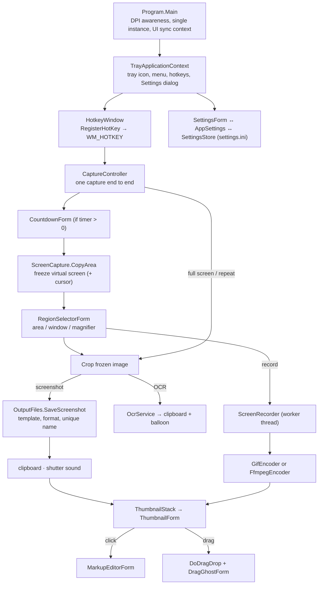

# Snapshot — Architecture

A macOS-style screenshot and screen-recording tool for Windows: press a hotkey, get a file, and a draggable thumbnail slides into the bottom-right corner of the screen. Everything lives in the notification area; there is no main window.

- Language/runtime: C# 5 on .NET Framework 4.x (WinForms), compiled with the `csc.exe` that ships with Windows — nothing to install. C# 6+ syntax (`?.`, `$""`, `=>` members) is unavailable with this compiler.
- Output: one portable `Snapshot.exe`. There is no installer.

## Features and defaults

| Feature | Default hotkey | Where it is implemented |
| --- | --- | --- |
| Capture a dragged area | `Ctrl+Shift+4` | `Capture/RegionSelectorForm` in region mode |
| Capture a window (also `Space` while selecting an area) | `Ctrl+Shift+2` | `RegionSelectorForm` in window mode + `Capture/WindowFinder` |
| Capture the whole screen under the cursor | `Ctrl+Shift+3` | `CaptureController.CaptureScreenUnderCursor` |
| Repeat the last selection | `Ctrl+Shift+1` | `CaptureController.RepeatLastRegion` |
| Copy text from the screen (OCR) | `Ctrl+Shift+6` | `Capture/OcrService` (Windows OCR) |
| Record the screen as GIF (or MP4 with ffmpeg) | `Ctrl+Shift+5` | `Recording/*` |
| Timer delay (3 / 5 / 10 s) | tray menu → Timer | `Capture/CountdownForm` |

All hotkeys are changeable in Settings. While selecting an area: `Space` toggles window mode and `Esc` cancels. The magnifier that follows the pointer and shows its pixel colour (`C` copies the colour) is **off by default**; enable it in Settings → Capture.

After a capture: the file is saved, optionally copied to the clipboard, a shutter sound plays, and a thumbnail slides in. Thumbnails stack (newest at the bottom) and each dismisses itself after 6 seconds unless the mouse is over it.

| Thumbnail action | Result |
| --- | --- |
| Drag it | The image follows the cursor; dropping hands the file to the target (copy). Dropping somewhere that refuses it snaps the thumbnail back |
| Click (screenshot) | Opens the Markup editor |
| Click (recording) | Opens the file in the default viewer |
| Right-click | Copy · Open · Markup · Show in Folder · Save As · Move to Recycle Bin · Dismiss |

## Data flow



The screen is frozen **before** the selector appears, so the saved image never contains the overlay, and anything that closes on focus loss (menus, tooltips) is still captured.

## Directory placement patterns

```text
# Depth ladder — start flat, escalate one level only when a real sibling appears.
# Files are grouped by responsibility only once two or more of them share one;
# a folder with a single real file should not exist. One top-level type per file,
# named after the file.
#
# Dependency flow is one-way:
#   Program → Tray → Capture / Thumbnails / Markup / Recording / Settings → Common

[Project Root]/
├── src/
│   ├── Program.cs                      # Entry point: per-monitor-v2 DPI awareness, single-instance mutex, UI synchronisation context
│   │
│   ├── Common/                         # Shared building blocks with no feature logic of their own
│   │   ├── AppInfo.cs                  # App name (mutex, registry value, AppData folder) and settings file path — the one place to rename the app
│   │   ├── NativeMethods.cs            # All user32/gdi32/dwmapi P/Invoke declarations
│   │   ├── DisplayScale.cs             # System DPI factor for sizes that are written in pixels
│   │   ├── Loc.cs                      # English/Thai strings, one row per key so a translation can't be half-missing
│   │   ├── NonActivatingPopupForm.cs   # Base for popups that must not steal focus; optional click-through
│   │   ├── ClipboardHelper.cs          # Clipboard writes with retry (image, text, file)
│   │   └── OutputFiles.cs              # File-name template, unique paths, PNG/JPG/BMP encoding
│   │
│   ├── Settings/                       # Everything the user can configure
│   │   ├── AppSettings.cs              # AppSettings (+ enums) and SettingsStore, the INI reader/writer that repairs bad values
│   │   ├── Hotkey.cs                   # Modifiers + key, parse/format ("Ctrl+Shift+4")
│   │   ├── HotkeyBox.cs                # Text box that records the shortcut pressed in it
│   │   ├── SettingsForm.cs             # Tabbed dialog: General, Capture, Hotkeys, Recording
│   │   └── StartupRegistration.cs      # "Start with Windows" via the HKCU Run key (registry is the single source of truth)
│   │
│   ├── Tray/                           # The always-running shell of the app
│   │   ├── TrayApplicationContext.cs   # Tray icon + menu, hotkey (re)registration, opens Settings, applies and saves changes
│   │   ├── TrayIcons.cs                # Idle and recording icons drawn at runtime (no .ico resource)
│   │   └── HotkeyWindow.cs             # Hidden window that receives WM_HOTKEY
│   │
│   ├── Capture/                        # Taking a still picture or text from the screen
│   │   ├── CaptureController.cs        # Orchestrates delay → capture → save → clipboard/sound → thumbnail; also OCR and recording start
│   │   ├── ScreenCapture.cs            # CopyFromScreen + optional mouse pointer
│   │   ├── WindowFinder.cs             # Visible top-level window bounds, topmost first (DWM frame, skips cloaked/own windows)
│   │   ├── RegionSelectorForm.cs       # Full-screen overlay on the frozen image: area/window modes, magnifier, colour picker
│   │   ├── CountdownForm.cs            # "Capturing in N…" toast for the timer
│   │   ├── ShutterSound.cs             # Shutter click synthesised in memory
│   │   └── OcrService.cs               # Windows.Media.Ocr called by reflection (this compiler can't reference the WinRT metadata)
│   │
│   ├── Thumbnails/                     # The macOS-style floating preview
│   │   ├── ThumbnailForm.cs            # One preview: slide animation, drag-out, click, context menu, auto-dismiss
│   │   ├── ThumbnailStack.cs           # Stacks up to 5 previews bottom-right, newest lowest
│   │   └── DragGhostForm.cs            # Click-through picture that follows the cursor during a drag
│   │
│   ├── Markup/                         # Editing a saved screenshot
│   │   ├── MarkupEditorForm.cs         # Window and toolbar: tools, colour, thickness, undo, save, save a copy, copy
│   │   ├── MarkupCanvas.cs             # Scaled preview and mouse handling; renders the final bitmap
│   │   ├── MarkupAnnotations.cs        # Pen, arrow, rectangle, ellipse, text, pixelate — stored in image coordinates
│   │   └── TextPromptForm.cs           # Small dialog asking for annotation text
│   │
│   └── Recording/                      # Moving pictures
│       ├── ScreenRecorder.cs           # Worker thread: capture loop at the chosen FPS, hands frames to an encoder
│       ├── IFrameEncoder.cs            # AddFrame(frame, timestamp) / Finish(endTimestamp)
│       ├── GifEncoder.cs               # Streaming GIF: fixed 252-colour palette, changed-rectangle frames, own LZW
│       ├── FfmpegEncoder.cs            # Pipes raw frames to ffmpeg.exe for H.264 MP4 (only when ffmpeg is on PATH)
│       └── RecordingFrameForm.cs       # Red outline drawn just outside the recorded region
│
├── tests/
│   └── SelfTests.cs                    # Console harness: asserts logic, renders forms to tests/out/*.png; run with `build.ps1 -Test`
│
├── build.ps1                           # Compiles src/**/*.cs → Snapshot.exe (or tests → SelfTests.exe with -Test)
├── Snapshot.exe                        # Built artifact, committed so the tool runs without a build step
├── ARCHITECTURE.md                     # Authoritative file-placement and data-footprint rules
└── .gitignore                          # Ignores tests/out and the test executable
```

**Adding a feature:** put it in the folder that owns its responsibility; create a new folder only when two or more files would share a responsibility no existing folder owns. Anything used by two or more feature folders moves to `Common/`. Every user-visible string goes through `Loc.T` and must exist in both languages (the self-test scans the source and fails otherwise).

## Runtime footprint

Where the tool reads, writes or registers anything once it is running. This is the complete list.

```text
# Files on disk

%USERPROFILE%\
└── Pictures\                           # Resolved through the Windows "Pictures" known folder, so OneDrive redirection is honored
    └── Screenshots\                    # Default save folder; changeable in Settings; created on first save if missing
        ├── Screenshot {yyyy-MM-dd} at {HH.mm.ss}.png|jpg|bmp   # One per capture; the template and format are configurable
        └── Screen Recording {yyyy-MM-dd} at {HH.mm.ss}.gif|mp4 # One per recording
                                        # Duplicates get " (2)", " (3)"…; the app never deletes files, except "Move to Recycle Bin" on a thumbnail, which the user chooses

%APPDATA%\
└── Snapshot\
    └── settings.ini                    # Key=Value lines: save folder, file name template, format, JPEG quality, clipboard/sound/cursor/magnifier flags,
                                        # timer delay, language, recording options, one Hotkey.<Action> line per action.
                                        # Created the first time a setting changes; unreadable lines fall back to defaults

[Wherever Snapshot.exe is placed]/
└── Snapshot.exe                        # Portable; reads no sidecar files
```

```text
# Registered with Windows

HKEY_CURRENT_USER\Software\Microsoft\Windows\CurrentVersion\Run
└── Snapshot = "<path>\Snapshot.exe"     # Written only while "Start when Windows starts" is ticked; unticking deletes the value

# Process-scoped — released on exit

Windows session/
├── Global hotkeys                      # One per action (defaults Ctrl+Shift+1…6); released while Settings is open so they can be re-typed;
│                                       # a combination another program owns is reported in a tray balloon, the rest keep working
├── Notification-area icon              # NotifyIcon with the menu; turns into a red dot while recording
├── Named mutex "Snapshot.SingleInstance" # A second launch exits silently
└── Memory only                         # Frozen virtual-screen bitmap + dimmed copy while selecting; scaled thumbnails; markup canvas;
                                        # GIF/MP4 are streamed to disk, so memory does not grow with recording length
```

| Touches | How |
| --- | --- |
| Clipboard | Only when asked: "also copy to clipboard", thumbnail → Copy, Markup → Copy, OCR text, colour picker (`C`) |
| Other programs | Drag hands over the **file path** (`FileDrop`, copy effect); click/Open uses the shell's default for the file type; Show in Folder starts `explorer.exe`; MP4 starts `ffmpeg.exe` as a child that exits with the recording |
| Windows services | OCR uses the on-device Windows OCR engine (no network); needs an OCR language installed in Windows |

**Not used:** network, temp files, logs, telemetry.

## Uninstall

1. Untick "Start when Windows starts" in Settings (removes the Run value), then quit from the tray icon.
2. Delete `Snapshot.exe`.
3. Optionally delete `%APPDATA%\Snapshot` and the images in `Pictures\Screenshots`.

## Decisions and limits

- **Freeze first, select second** — see Data flow. Costs one full-screen copy per capture.
- **Window capture crops the frozen screenshot** at the window's DWM frame. If another window overlaps the chosen one, the overlap is in the picture (PrintWindow would avoid that but renders some apps wrongly).
- **OCR by reflection** — the Windows 11 WinRT metadata is split into many files that this compiler cannot reference, so `OcrService` bridges `IAsyncOperation<T>` to `Task<T>` by hand. It reads the languages in the user's Windows profile; Thai OCR works only if Windows has that language pack.
- **GIF quality** — a fixed 252-colour palette without dithering keeps encoding cheap and streaming; photos look banded, UI recordings look fine. For smoother or smaller output use MP4 (needs `ffmpeg.exe` on PATH; the option is hidden otherwise).
- **MP4 and GIF sizes** are rounded down to even dimensions (encoder requirement).
- **Recording blocks other captures**: while recording, the record hotkey only stops it.
- **Thumbnails use the system DPI** (`GetDpiForSystem`) and always appear on the primary screen.
- Requires Windows 10 1703 or later (per-monitor v2 DPI awareness).

## Testing

```powershell
.\build.ps1 -Test
```

Runs `tests/SelfTests.cs` without touching the mouse or keyboard and without opening visible windows: hotkey parsing, settings round-trip and repair, file naming and encoders, language-key coverage, the GIF encoder (decoded back with GDI+ and compared pixel by pixel), OCR on rendered text, and rendering of Settings, Markup, thumbnails and the selector overlay to `tests/out/*.png` for visual inspection (forms are shown far off-screen without activation).

Not covered automatically: hotkey presses, the live drag-and-drop with the ghost image, the tray menu, and real recording sessions — try these by hand after a change.

## Build

```powershell
.\build.ps1
```
